# How the harness works

This is a walk-through of what happens inside the harness, from a question in `data/questions.json` to a number in `report.md`. The [README](README.md) covers what the experiment is and how to run it; this file covers how it works. The diagrams are Mermaid, which GitHub renders inline.

- [1. The big picture](#1-the-big-picture)
- [2. Data: corpus, questions, registry](#2-data-corpus-questions-registry)
- [3. Retrieval](#3-retrieval)
- [4. The mock version registry](#4-the-mock-version-registry)
- [5. The tool loop](#5-the-tool-loop)
- [6. The eight arms](#6-the-eight-arms)
- [7. Talking to OpenRouter](#7-talking-to-openrouter)
- [8. Running both models in parallel](#8-running-both-models-in-parallel)
- [9. Scoring](#9-scoring)
- [10. The report and the closure rule](#10-the-report-and-the-closure-rule)
- [11. Cost estimates](#11-cost-estimates)
- [12. Extending it](#12-extending-it)

---

## 1. The big picture

Each **run** is one (model, arm, question, seed, condition) combination. A stage, like `sweep`, is just a long list of runs. Every run goes through the same pipeline, and every step writes to a log, so any number in the report can be traced back to the exact requests that produced it.

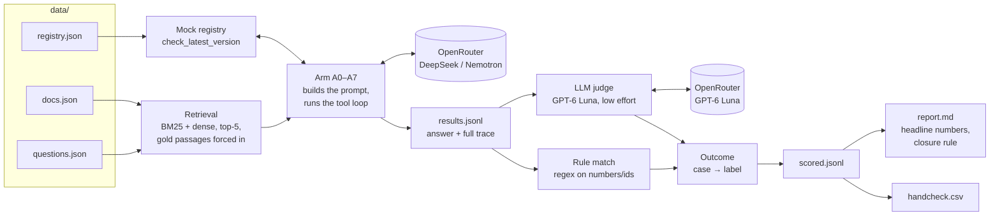

Code map:

| Step | Module |
|---|---|
| Loading data | `harness/data.py` |
| Retrieval | `harness/retrieval.py` |
| Registry | `harness/registry.py` |
| Arms and tool loop | `harness/arms.py`, prompt text in `harness/prompts.py` |
| Model calls | `harness/llm.py` |
| Running jobs, caching, logging | `harness/runner.py` |
| Rules, judge, outcomes | `harness/scoring.py` |
| Report, hand-check, confirmation set | `harness/report.py` |
| Cost estimates | `harness/estimate.py` |
| Settings and model table | `harness/config.py` |
| Command line | `harness/__main__.py` |

---

## 2. Data: corpus, questions, registry

Three JSON files hold everything the experiment knows. They're meant to be frozen in Git before the main sweep, and each run records the commit it used.

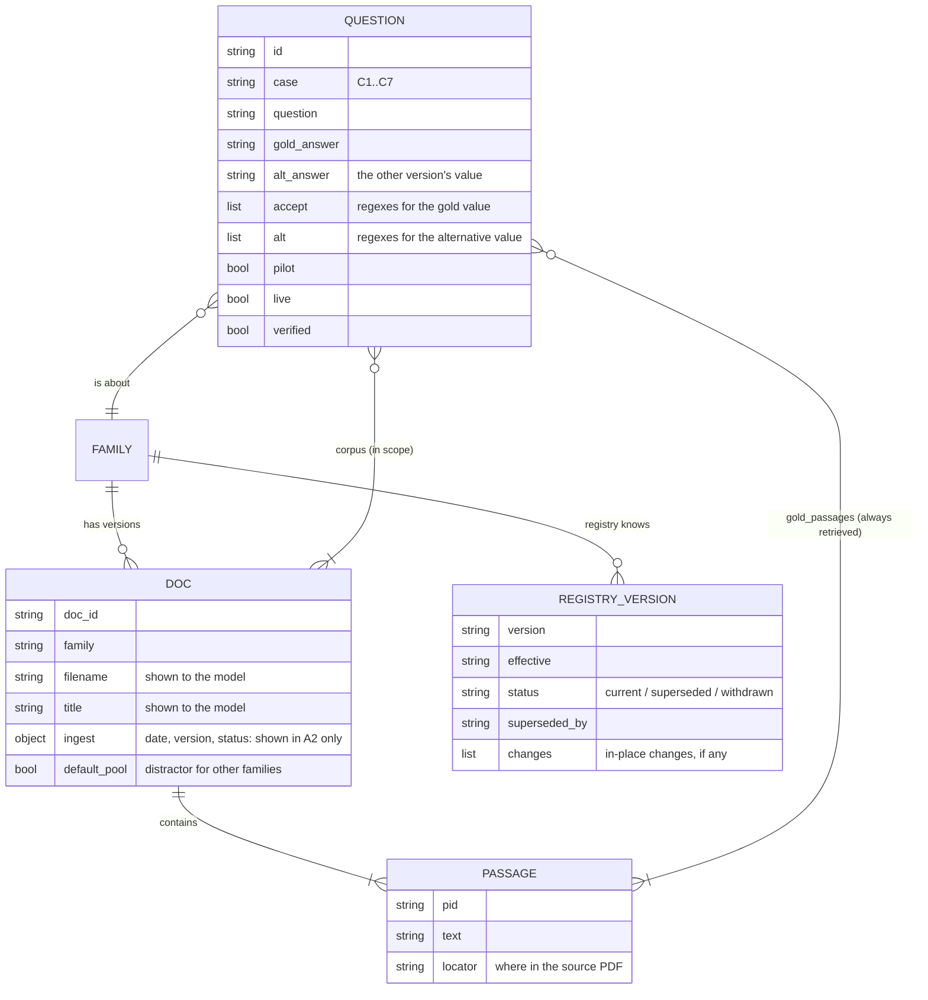

How the case types are built from the corpus:

| Case | What's in the question's `corpus` | What the registry says |
|---|---|---|
| C1 | old and new versions | old is superseded, new is current |
| C2 | old version only | old is superseded by a version that isn't in the corpus |
| C3 | an undated variant (`*-undated`) | can't match a version, so it lists all known versions |
| C4 | base text only (NISPOM, NIST Rev 5 as first published) | current, but lists in-place changes dated later |
| C5 | old and new; the question names the old one | as C1 |
| C6 | old and new; the value is the same in both | as C1 |
| C7 | a doc whose filename/title say one version and whose text says another (`*-c7`) | the version from the filename, i.e. "current" |

C7 is a deliberate trap: the registry lookup succeeds and says "current", so only a model that reads the passage text notices that the header contradicts the filename.

---

## 3. Retrieval

Retrieval runs once per question, before any arm, and every arm and every model sees exactly the same five passages. Retrieval isn't what's being tested, so the version passages that matter are always included.

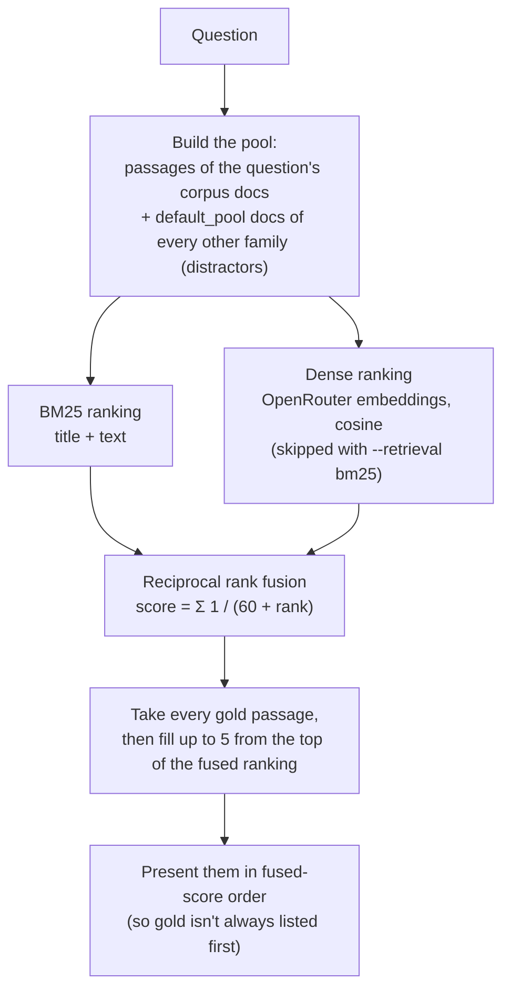

Embeddings are cached on disk by (model, text), so the corpus is embedded once. If a question's gold passage isn't in its own corpus, retrieval raises an error, and the tests catch that for every question.

---

## 4. The mock version registry

`check_latest_version(title_or_id)` is a lookup against `data/registry.json`. The matching is deliberately simple and predictable, so that results depend on the model's behaviour, not on fuzzy search luck.

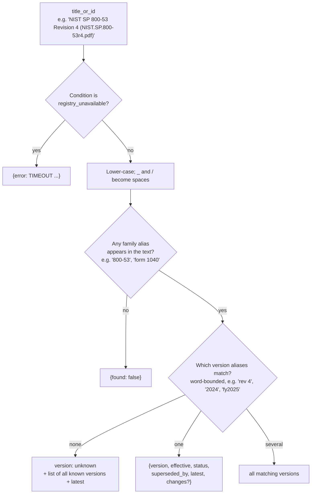

Undated documents (C3) naturally land on "version: unknown". Their titles carry no version string, so the registry can only say which versions exist, not which one the passage came from. That's exactly the situation a real lookup would be in.

The registry is a **frozen universe**: "latest" means latest among the versions in the experiment, not today's real-world latest.

---

## 5. The tool loop

Every arm that gives the model tools uses the same loop, in `arms.tool_loop`. It's written by hand, not left to an SDK, so every turn can be logged and the same code works for every model on OpenRouter.

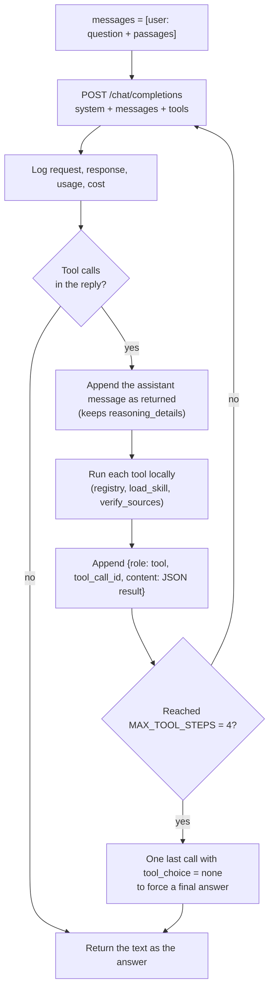

Details that matter:

- **Reasoning is kept across turns.** The assistant message goes back into the history exactly as OpenRouter returned it, including `reasoning_details`. Reasoning models need that to continue properly after a tool call; Gemini's thought signatures are the best-known case.
- **Tool results are matched by id.** Each tool reply carries the `tool_call_id` of the call it answers.
- **Bad tool calls don't crash the run.** Unknown tool names and unparseable arguments come back to the model as an error result.
- **The loop is bounded.** At most 5 model calls per loop: 4 tool-using turns, then a forced answer.

---

## 6. The eight arms

All arms share the base system prompt ("answer from the passages in 1–3 sentences, cite passage numbers"). A1–A7 add the design doc's freshness line: *"Check document dates or versions; prefer the most current; say if a source may be outdated."* What differs is how much help the model gets, and who decides whether to check.

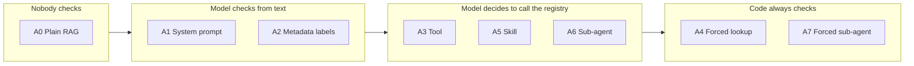

### A0, A1, A2: one call, no tools

These are a single model call. A0 has no freshness line. A1 adds it. A2 also adds an ingestion metadata line to each passage, i.e. what an ingestion pipeline could read off the document itself:

```
[2] Source: NIST.SP.800-53r4.pdf | "NIST SP 800-53 Revision 4: ..."
    Metadata: date=2013-04-30 | version=Rev 4 | status=withdrawn
```

### A3: optional tool call

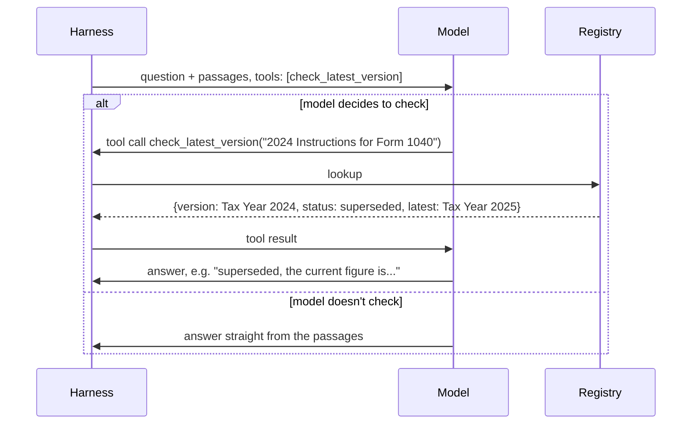

`check_invoked` in the results records whether the registry was actually queried. That's the "did the model remember to check" number.

### A4: forced harness check

The harness looks up every distinct retrieved document *before* the model sees anything, using the title and filename, the same text a model would pass. It writes the result onto the passage:

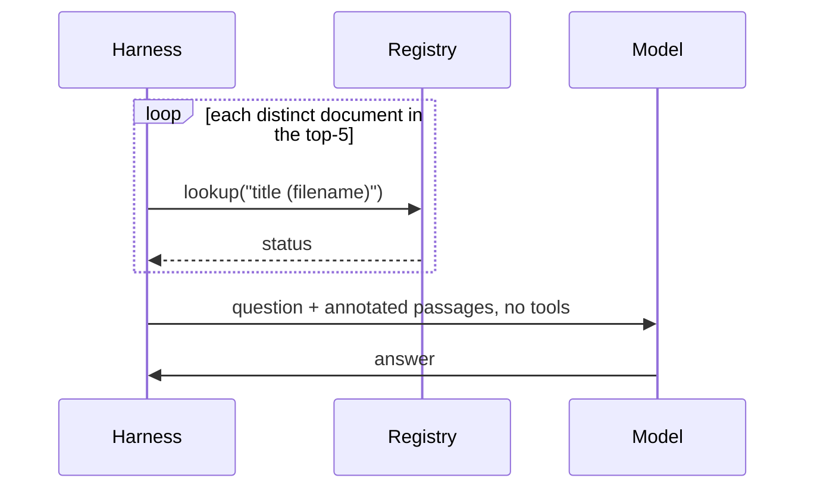

```
[1] Source: i1040gi_2024.pdf | "2024 Instructions for Form 1040"
    Registry check: IRS-1040-INSTR Tax Year 2024: SUPERSEDED, SUPERSEDED by Tax Year 2025; latest: Tax Year 2025.
```

### A5: skill

The model starts with only a `load_skill` tool. Loading `version-check` returns [`skills/version-check/SKILL.md`](skills/version-check/SKILL.md) and adds `check_latest_version` to the tool list for the rest of the conversation.

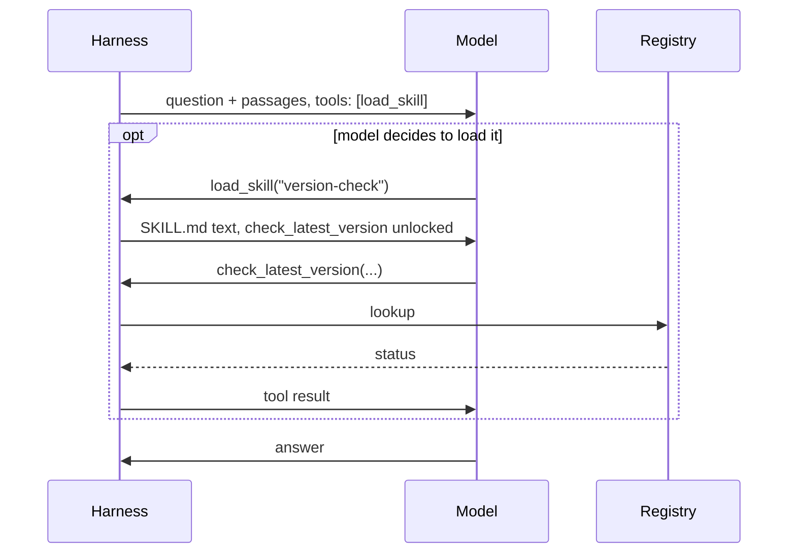

OpenRouter has no native skill primitive, so this simulates one the way agent harnesses implement skills: as on-demand instructions loaded by a tool call. The write-up should say so.

### A6 and A7: verifier sub-agent

The verifier is a separate tool loop with its own system prompt. It sees **only the passages**, not the question, plus the registry tool, and returns one JSON object per document: `{doc, status, latest_value, confidence, note}`. Its status is one of `current`, `superseded`, `withdrawn`, `amended`, `unverifiable`, `inconsistent` or `unable_to_verify`.

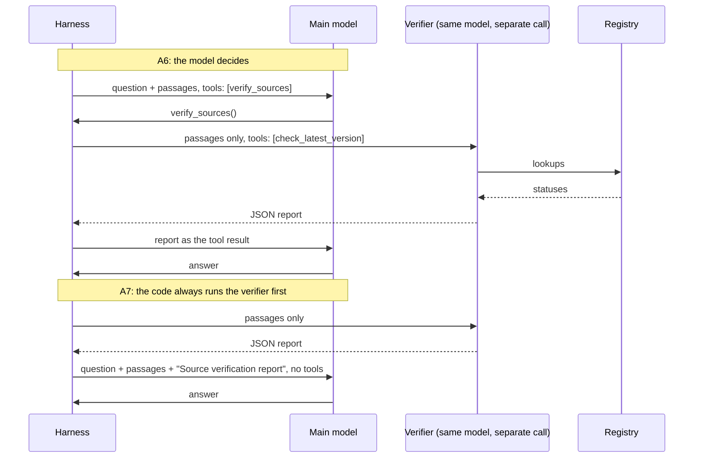

If the verifier's JSON can't be parsed, its raw text is passed on instead, and `parse_error` is logged.

### A3-web: the live condition

This is A3 with OpenRouter's `openrouter:web_search` server tool instead of the registry. OpenRouter runs the search itself, so there are no local tool calls. It's reported separately and isn't scored against the closure rule.

### The registry-unavailable condition

This uses the same arms, but every registry lookup returns `{error: TIMEOUT ...}`. A4 then annotates every passage with "REGISTRY UNAVAILABLE (timeout). Freshness not verified." The correct behaviour is to answer with an "unable to verify" warning.

---

## 7. Talking to OpenRouter

`harness/llm.py` is a small OpenAI-compatible client, used for every model: the ones under test, the verifier and the judge.

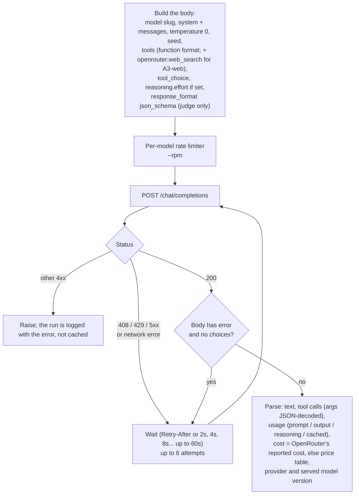

- **Pinned versions:** models are pinned to dated slugs where OpenRouter has one, e.g. `deepseek/deepseek-v4.1-flash-20260910`, so results don't drift mid-run. The model version and provider actually served are logged anyway.
- **Reasoning effort:** this comes from the model table: model default for DeepSeek and Nemotron, `low` for the judge. `TTS_REASONING_EFFORT` and `TTS_JUDGE_REASONING_EFFORT` override it.
- **Usage:** reasoning tokens are split out of `completion_tokens`, so the log shows how much each model "thinks". That's the biggest driver of cost.

---

## 8. Running both models in parallel

`run` builds one list of jobs per model and **interleaves** them (`runner.interleave`), alternating models, before handing everything to a single thread pool. So both models progress together, and if you stop halfway through, both are about halfway done.

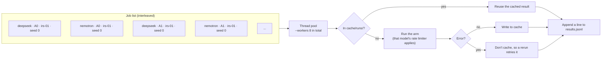

Each model has its own client and its own rate limiter, so a slow or rate-limited provider for one model doesn't throttle the other.

**Cache keys:**

| Cache | Key | Location |
|---|---|---|
| Runs | model slug, reasoning effort, arm, question, seed, condition, prompt version, retrieved passage ids | `cache/runs/` |
| Judge labels | judge model, judge effort, prompt version, judge prompt, question, answer | `cache/judge/` |
| Embeddings | embedding model, text | `cache/embeddings.json` |

`PROMPT_VERSION` in `config.py` is part of the run key, so changing a prompt or an arm and bumping it makes sure stale cached answers aren't reused.

---

## 9. Scoring

Scoring turns each answer into one outcome label, in three steps: a rule match, a judge label, and a fixed mapping from case type + labels to outcome.

### Step 1: rule match

For questions with a numeric or short-identifier answer, `accept` and `alt` regexes are tried against the normalised answer (lower-case, `$` and thousands separators removed, so "$15,750" becomes "15750").

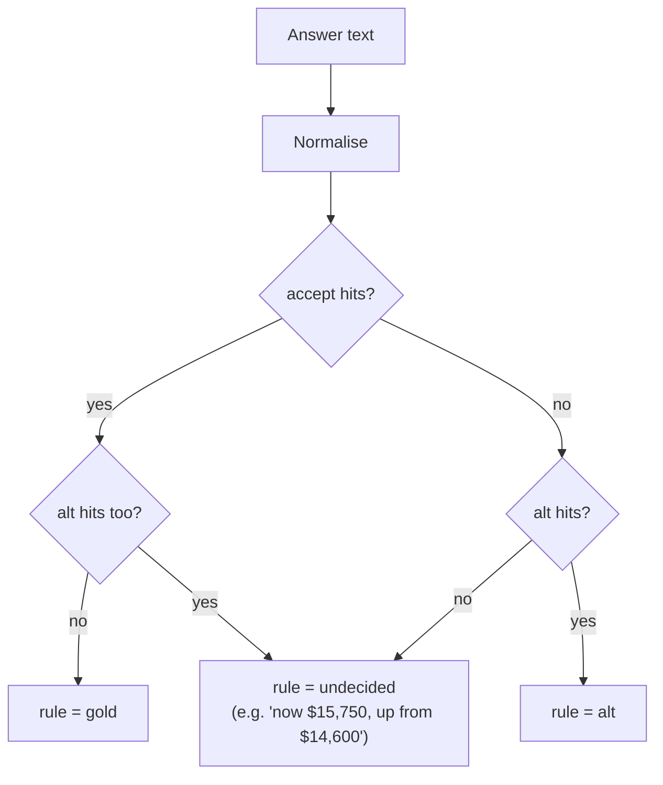

### Step 2: the judge

GPT-6 Luna (low effort) gets the question, the reference answer, the alternative answer and the answer to label. It must reply in a strict JSON schema:

| Field | Values |
|---|---|
| `answer_matches` | `gold`, `alt`, `both`, `neither`, `no_answer`: which value the answer presents as its answer |
| `flags` | any of `outdated`, `unverifiable`, `inconsistent`, `unable_to_verify`: every freshness warning the answer actually makes |
| `mentions_newer_version` | whether a newer version is mentioned at all, warning or not |
| `rationale` | one or two sentences |

Simply citing a source's year isn't a flag, and neither is mentioning a newer value as history. The judge's instructions spell this out, because the line between "useful context" and "false flag" is exactly what C5 and C6 test.

**The rule wins when it's decided.** `matches = rule if rule is not None else judge.answer_matches`. When both exist and disagree, the row is marked `disagreement` and goes to the hand-check.

### Step 3: case → outcome

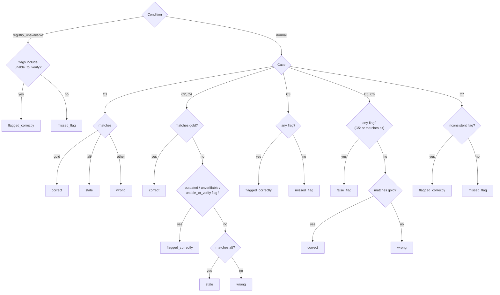

### Hand-check

`handcheck` exports every disagreement plus a seeded random 10% sample to `handcheck.csv`, with empty `human_outcome` and `human_note` columns for the team. That's the design doc's "hand-check a 10% sample plus all disagreements".

---

## 10. The report and the closure rule

`report.md` groups scored runs by **model** and **condition**, then by arm, keeping only the latest row per job. So there's one table for DeepSeek and one for Nemotron.

| Column | Computed over | Definition |
|---|---|---|
| Stale C1–C2 ↓ | C1 + C2 runs | share with outcome `stale` |
| Unverifiable handled C3–C4 ↑ | C3 + C4 runs | share `correct` or `flagged_correctly` |
| False flag C5–C6 ↓ | C5 + C6 runs | share `false_flag` |
| C7 flagged ↑ | C7 runs | share `flagged_correctly` |
| Overall OK | all runs | share `correct` or `flagged_correctly` |
| Registry checked (C2–C4) | C2–C4 runs, arms A3–A7 | share where the registry was actually queried |
| Cost / 100 Qs | all runs | mean OpenRouter cost per run × 100 (judge cost excluded) |
| Calls, Latency | all runs | means |

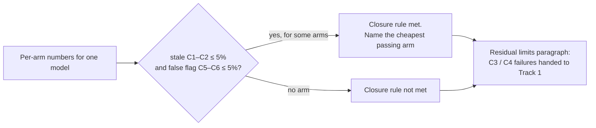

Below each table is an "Outcomes by case" breakdown, which is where the residual-limits paragraph comes from: undated documents and in-place amendments that no date check can catch. The report ends with the number of disagreements, runs with an empty answer or an error, and the judge's total cost.

`select-confirm` (only needed if a confirmation round is ever run) picks every question that any arm got wrong, plus a stratified random 25 across case types. It pairs them with arms A1, A4 and whichever model-driven arm (A3 / A5 / A6) had the lowest stale + false-flag rate.

---

## 11. Cost estimates

`estimate` multiplies the run plan by per-call token assumptions and the price table:

```
cost = Σ over stages and arms:  runs × calls_per_run(arm) × (in_tokens × $in + out_tokens × $out) / 1M
judge = runs × (900 × $in + judge_out(effort) × $out) / 1M
```

- **Calls per run** follow from how each arm works: A0–A2 and A4 make 1 call, A3 makes 2, A5 3, A6 4 and A7 3.
- **Two token scenarios:** low is 1,100 in / 400 out per call, high is 1,600 in / 1,500 out.
- **Judge output** depends on its effort: about 250–600 tokens at `low`.

With `--from-run pilot`, it replaces the assumptions with what the pilot actually measured per arm: calls per run, prompt tokens per call, and output + reasoning tokens per call. That's the more trustworthy figure.

---

## 12. Extending it

**Add a model.** Add a line to `MODELS` in `harness/config.py` with an alias, slug, price, reasoning effort and tier. Then run it with `--models <alias>` or add it to `TTS_MODELS`. Raw OpenRouter slugs work too, without a table entry; they just won't appear in estimates. Run `preflight --models <alias>` first.

**Switch the judge.** Set `TTS_JUDGE_MODEL=gpt-6-sol`. The judge must support strict JSON-schema output, which preflight checks.

**Add an arm.** Write a function `aX(ctx) -> str` in `harness/arms.py`, using `single_call` or `tool_loop`. Register it in `ARM_FUNCS` and add it to `config.ARMS`, and to `REGISTRY_ARMS` / `MODEL_DRIVEN_ARMS` if relevant. Add its calls-per-run to `estimate.CALLS_PER_RUN`. Then bump `PROMPT_VERSION`.

**Add questions or documents.** See "Adding a question" in the README. `python -m pytest` validates the whole data set offline.
